  

### Hi there 👋

I'm Rodrigo — a **Customer Engineer at Cloudflare**, where I help teams design and ship things on the edge.

Before that I spent years as a software engineer across a few different companies, building backends, mobile apps and web platforms. I started my career at **Cisco**, which is where the networking bug bit me — and it never really let go. Packets, protocols and the weird places latency hides are still my favourite rabbit hole.

Outside work I tinker with AI agent tooling, dotfiles I'll never stop tweaking, and small space-themed side projects.

### What I work with

**Edge & Cloudflare** — building and troubleshooting on Cloudflare's platform, from DNS and TLS to application delivery.

**Networking** — TCP/IP, routing, BGP, DNS, TLS. The layer everything else quietly depends on.

**Agent tooling & AI** — TypeScript, Bun, OpenCode plugins, Biome, Vitest.

**Backend & full-stack** — Node.js, React, JavaScript, Java, Python, Shell, Docker, HTML/CSS.

### A few things I've built

- [opencode-council](https://github.com/RoderickOxen/opencode-council) — multi-agent council plugin for OpenCode
- [dotfiles](https://github.com/RoderickOxen/dotfiles) — zsh, ghostty, and my OpenCode agent setup
- [space-talk](https://github.com/RoderickOxen/space-talk) · [space-apod](https://github.com/RoderickOxen/space-apod) — the space corner
- [roderickoxen.github.io](https://roderickoxen.github.io) — occasional writing

🗿 Portugal
